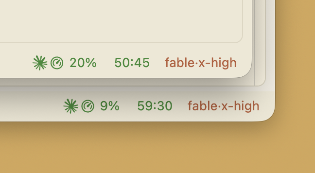
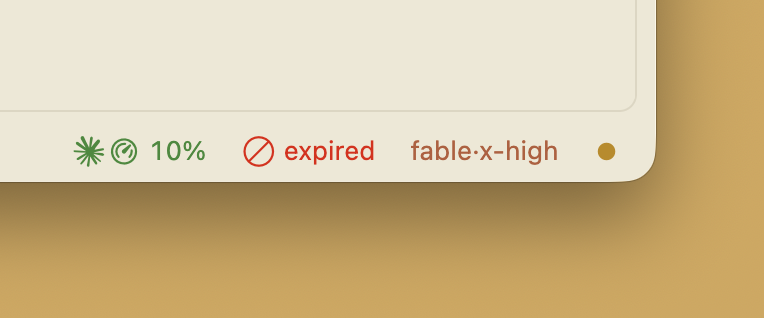
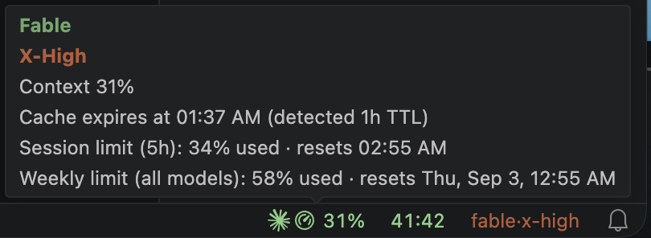

# Brain Drain for Claude Code

<p align="center">
  <a href="https://marketplace.visualstudio.com/items?itemName=makingaipractical.claude-code-fuel-gauge"></a>
  <a href="https://marketplace.visualstudio.com/items?itemName=makingaipractical.claude-code-fuel-gauge"></a>
</p>

Brain Drain puts four Claude Code readouts in your VS Code status bar: how full the context window is, how long your prompt cache has left, which model and effort level the session is running, and how close you are to your usage limits on Anthropic subscription plans.

**Not in VS Code, or want it under the prompt?** Brain Drain also comes as a [Claude Code mod](https://github.com/makingaipractical/brain-drain-for-claude-code) (Claude Code 2.1.287 or later) that draws the same figures under Claude Code's prompt in any terminal. Use either one, or both.

**Terminal sessions only.** Brain Drain sees `claude` sessions started in a terminal, including VS Code's integrated terminal. It cannot see sessions in the chat panel of Anthropic's Claude Code extension, because the chat panel does not run the status line (checked on Claude Code 2.1.296).

<p align="center">
  
</p>

## Everything stays on your machine

Brain Drain never logs into your Claude account. It has no account of its own, no API key and no telemetry, and it makes *no network calls of any kind*. Every number it shows comes from data Claude Code hands to its status line command on your own machine, plus the end of the session transcript Claude Code already writes.

The complete list of what it reads and writes is in [Privacy](#privacy) further down, and in [SECURITY.md](SECURITY.md): five places, all under `~/.claude` or VS Code's own storage.

## The cache countdown

Anthropic keeps the front of your conversation warm in a prompt cache: for an hour on a Claude subscription within its included usage, and for five minutes once you draw on usage credits or use an API key ([Claude Code docs](https://code.claude.com/docs/en/prompt-caching)). While it is warm, your next message reuses it. Let it go cold and the whole conversation is read again from the start: the next turn is slower, and on API billing it costs more.

Brain Drain shows the time you have left as its own status bar item, with its own colour, so cache urgency reads independently of how full your context is. None of the other Claude Code extensions I checked in August 2026 shows this. Here a comfortable `10%` context sits in green next to an `expired` cache in red — and the amber dot on the right is the usage alert, lit because a usage limit crossed 70%.

<p align="center">
  
</p>

- **Counting down** — `M:SS`, inherits the context colour while there is comfortable time left
- **Under a minute** — yellow
- **Expiring (<15s)** — red
- **Expired** — `expired` label in red with a circle-slash icon
- **Hidden** — when there is no cache state yet (fresh session, just after `/compact`)

**How exact it is.** The cache lifetime is read, not guessed. Claude Code records on every turn which cache it asked for, the five-minute one or the one-hour one, and Brain Drain reads the most recent of those entries from the end of the session transcript. That reading is exact, and it corrects itself on the next update. From 95% of your 5-hour limit the cache hover also warns that the lifetime may drop, because going over the limit onto usage credits means the five-minute cache. The answer is saved to `~/.claude/fuel-gauge/account_ttl.json`, so a new session's countdown is right from its first second.

The countdown starts again from the full lifetime whenever Claude Code reports a new request to the model. If the record cannot be read — an older Claude Code that does not say where the transcript is, or a file that will not open — Brain Drain falls back to the one thing the token counts can prove on their own: a cache that survived more than five minutes is not a five-minute cache. `fuel-gauge.cacheTTL` overrides all of it, if you would rather fix the value yourself.

## The other three readouts

Brain Drain shows up to four readouts, right-aligned, plus a warning when Claude runs in the wrong folder, and one shared hover tooltip that breaks everything down.

<p align="center">
  
</p>

### Context percentage

How full the context window is, updated live and colour-coded green → yellow → red. It also covers `claude` sessions in the integrated terminal, which Claude Code's own indicator did not when I checked in August 2026.

- **Active** — coloured percentage, using your thresholds
- **Stale** — the percentage with no colour: no update for over an hour, so the session is treated as abandoned. The usage dot is hidden too, because old limit numbers mislead.
- **Reading paused** — `~42%`, no colour: right after `/compact` Claude Code reports an empty context window until your next turn, so the gauge holds the last number it had and marks it with a tilde rather than dropping to a green 0%
- **Unreliable** — `NN%` with a warning icon and no colour: Claude Code reported a context window smaller than the tokens already in it, which cannot be true. The number is shown as Claude Code gave it, not corrected; the hover explains.
- **No session** — the gauge is hidden. It appears when a Claude Code session starts in the folder this window has open

The percentage is exactly the one Claude Code reports. Run `/context` in a session, or read Claude Code's own status line, and you will see the same figure. It will not match the small pie in the VS Code prompt box, or the "Context low" message in the terminal, because those two measure how much room is left before Claude Code compacts your conversation automatically. They answer a different question, so their numbers differ. See [Known issues](#known-issues).

### Model and effort

A compact item like `opus·x-high`, coloured by effort level, gold when you are running `max`. Hover for the full model name and the effort spelled out. Seeing `opus·max` on a medium-sized task is what makes you dial it down: each effort level "trades token spend against capability" ([model configuration](https://code.claude.com/docs/en/model-config)). Hide the item with `fuel-gauge.effortStyle: off`. The effort part only appears when the current model reports an effort level.

It also shows you when a session is no longer running the model you picked. Anthropic's Fable tier ships with [additional safety measures for dual-use capabilities](https://www.anthropic.com/news/claude-fable-5-mythos-5): when Fable's classifiers detect a request in certain areas — cybersecurity, for one — the response is handled by Opus instead, by Anthropic's own account. Claude Code does announce the switch, but the notice is easy to miss in the stream of terminal text — `fable·x-high` becoming `opus·x-high` in the status bar stays put until you see it.

### Usage limits

Your session (5-hour) and weekly usage live in the **hover tooltip**, each with its reset time. To keep the bar quiet, that is the only place the numbers appear, until a limit gets high:

- **Running hot** — when your 5-hour or weekly usage crosses 70%, a coloured dot appears in the bar (yellow ≥70%, red ≥90%). Hover it for the exact percentages and reset times.
- **Hidden** — below 70%, and whenever Claude Code sends no limit data (API-key sessions, or before the session's first response). Hidden means hidden: no misleading 0%.

Turn the whole usage display off with `fuel-gauge.showUsage: false`.

## Install

Search for **Brain Drain for Claude Code** in the VS Code Extensions panel, or install from the command line:

```bash
code --install-extension makingaipractical.claude-code-fuel-gauge
```

For VS Code forks (Antigravity, Cursor, VSCodium), install it from [Open VSX](https://open-vsx.org/extension/makingaipractical/claude-code-fuel-gauge), or download the `.vsix` from the [Releases page](https://github.com/makingaipractical/claude-code-fuel-gauge/releases) and install via the extensions panel (three dots > "Install from VSIX").

Restart any running Claude Code sessions after installing. The extension sets up everything else automatically.

**Uninstall.** Run **Brain Drain: Restore Previous Status Line** first, so Claude Code's status line goes back to what it was, then uninstall the extension. You can delete `~/.claude/fuel-gauge/` and `~/.claude/scripts/context-bridge.sh` afterwards.

## How it works

Claude Code has a [statusline feature](https://code.claude.com/docs/en/statusline) that exposes session data as JSON. Brain Drain uses it in two parts:

1. **Bridge script** — installed automatically on first activation. Claude Code pipes session data to it, and it writes one small JSON file per session to `~/.claude/fuel-gauge/`.
2. **Extension** — polls that directory every 15 seconds, finds the session matching your current workspace, and shows the numbers in the status bar.

Everything — context, cache, model, effort, usage limits — rides that same local feed. No network calls, no API keys, no accounts.

Works for `claude` sessions in a terminal, including VS Code's integrated terminal. Sessions in the chat panel of Anthropic's Claude Code extension do not run the status line, so Brain Drain cannot see them (checked on Claude Code 2.1.296).

### The status line slot, and what Brain Drain writes

Claude Code allows **one** status line command, and Brain Drain's bridge needs it: the status
line is where Claude Code hands the 5-hour and weekly figures to a program outside itself
([statusline docs](https://code.claude.com/docs/en/statusline)). The Brain Drain mod runs inside
Claude Code and reads them directly.

If you already run your own status line (ccstatusline, a powerline script, anything),
Brain Drain asks before taking the slot, saves what was there, and can put it back:

- **Brain Drain: Restore Previous Status Line** — puts your command back and stops Brain Drain managing the slot.
- **Brain Drain: Connect Status Line** — asks again if you declined.
- **Brain Drain: Show Diagnostics** — read-only report if the gauge is dark.
- `fuel-gauge.manageStatusLine` — set to `false` to keep Brain Drain away from your settings entirely.

The bridge and your own status line cannot run at the same time. That is a Claude Code limitation, not a choice I made.

**To keep your own status line,** choose **Not now** when Brain Drain asks, and install the [Brain Drain mod](https://github.com/makingaipractical/brain-drain-for-claude-code). Whenever the bridge is not your status line, the mod writes the session file to `~/.claude/fuel-gauge/` itself, with the same fields, and the gauge reads it from there: context percentage, cache countdown, model·effort and the usage limits.

## Requirements

- VS Code 1.93+ (or a compatible fork)
- Claude Code CLI — works with any model and with both the 200k and 1M-token context windows
- `bash` and Python 3 — the bridge script is a shell script that uses `python3` to read Claude Code's JSON.
  On macOS, `python3` comes with the Xcode Command Line Tools. Most developers already have them; if you do not,
  the first run pops Apple's "Install command line developer tools?" dialog. Install them once with
  `xcode-select --install` and the gauge works from then on.
- Built and tested on macOS. Linux should work — the bridge needs nothing beyond `bash` and `python3` — but I have not run it there. Windows is untested; the bridge is a bash script, so at minimum it needs a `bash` on the path.
- Usage limits display: a Claude subscription plan (Pro/Max). API-key sessions don't have these limits, so the display stays hidden.
- Usage limits on a **Team plan**: Claude Code's status line documentation lists the limit figures for Pro and Max only ([statusline docs](https://code.claude.com/docs/en/statusline)), and Team users have reported them missing or intermittent ([claude-code#84995](https://github.com/anthropics/claude-code/issues/84995)). The usage dot and the hover lines may stay empty there. Everything else works normally.

## Settings

| Setting | Default | Description |
|---------|---------|-------------|
| `fuel-gauge.pollInterval` | 15 | How often to check for updates (seconds) |
| `fuel-gauge.warningThreshold` | 60 | Context % at which the indicator turns yellow |
| `fuel-gauge.dangerThreshold` | 80 | Context % at which the indicator turns red |
| `fuel-gauge.systemOverhead` | 0 | Deprecated, and safe to delete from your settings. A number of tokens to subtract from the context window before working out the percentage. Used only if Claude Code sends no percentage of its own |
| `fuel-gauge.cacheTTL` | `null` (auto) | How long the prompt cache lives, in seconds. Leave it empty and Brain Drain reads the answer from Claude Code's own record. Set `300` (5 minutes) or `3600` (1 hour) only to override that |
| `fuel-gauge.cacheWarningSeconds` | `null` (off) | Play 3 short beeps when the cache countdown drops below this many seconds. macOS only. Example: `180` for a 3-minute warning |
| `fuel-gauge.effortStyle` | `text` | Model·effort item: `text` to show it, `off` to hide it |
| `fuel-gauge.showUsage` | `true` | Show session/weekly usage in the hover, with the alert dot when a limit is high |
| `fuel-gauge.manageStatusLine` | `true` | Let Brain Drain use Claude Code's status line slot. Set to `false` to keep Brain Drain out of `~/.claude/settings.json` entirely. Without the Brain Drain mod, the gauge then shows a warning icon that you can click to connect |

To hide one item without hiding the rest, right-click the status bar. VS Code lists them as **Brain Drain: context**, **cache countdown**, **model and effort**, **usage alert** and **wrong folder**, and remembers what you switch off. No setting needed.

## If the gauge is dark

1. Restart the Claude Code session. This also fixes numbers that have stopped updating.
2. Accept the folder's workspace-trust prompt. Claude Code runs the status line command only in a trusted folder.
3. Check that `~/.claude/settings.json` does not set `"disableAllHooks": true`, which also stops a custom status line ([mods overview](https://code.claude.com/docs/en/plugins/mods/overview)).
4. Look for a red **wrong folder** item (see [Known issues](#known-issues)).
5. Run **Brain Drain: Show Diagnostics**.

## Known issues

**The percentage will not match VS Code's pie or the "Context low" message.** See [Context percentage](#context-percentage).

**No per-model weekly bar.** `/usage` shows Max users a per-model figure that Claude Code does not put in the status line data, and the only other way to it is a web request with your login credentials — which Brain Drain will not make. If Anthropic adds it to the status line, it will show up here.

**Wrong folder.** The gauge follows the session started in the folder this window has open. If you start `claude` from a terminal in this window, in a folder the window does not have open, a red **wrong folder** item appears. Hover it to see where Claude started and which folders the window has open. A start in a subfolder, or in any root of a multi-root workspace, is normal and shows nothing. Brain Drain changes nothing for you: quit that session and start Claude from the window's folder, or open the folder Claude is working in.

**Icons in forks.** Editors without the newer codicons (Antigravity, for one) show only the gauge icon, not the Claude icon next to it. Everything works the same.

## Questions, bugs and ideas

If something is broken, [open an issue](https://github.com/makingaipractical/claude-code-fuel-gauge/issues/new/choose) and pick the bug report template. It asks you to paste the output of the **Brain Drain: Show Diagnostics** command, which lists your settings file, the bridge script and the session files Brain Drain can see — that report answers most of the questions I would otherwise have to ask you, so please include it. Questions about how any of this works belong in [Discussions under Q&A](https://github.com/makingaipractical/claude-code-fuel-gauge/discussions/categories/q-a), and things you would like Brain Drain to do belong in [Discussions under Ideas](https://github.com/makingaipractical/claude-code-fuel-gauge/discussions/categories/ideas). If the extension is working for you, please leave a review on the [Marketplace](https://marketplace.visualstudio.com/items?itemName=makingaipractical.claude-code-fuel-gauge&ssr=false#review-details) or on [Open VSX](https://open-vsx.org/extension/makingaipractical/claude-code-fuel-gauge/reviews) — reviews are how other people find it.

If you would rather not use GitHub — or you want to talk about something that does not belong on a public tracker — email [info@makingaipractical.com](mailto:info@makingaipractical.com). And if you want to send a patch, [CONTRIBUTING.md](CONTRIBUTING.md) says how to run everything locally.

## Privacy

No API calls, no telemetry, no runtime dependencies, no account. Everything runs locally on Claude Code's own statusline data, including the usage numbers. This is the complete list of what Brain Drain reads and writes:

| File or folder | What Brain Drain does with it |
| --- | --- |
| `~/.claude/settings.json` | Reads it. Writes one key, `statusLine.command`. If the slot is empty, it connects at once and offers Undo. If another command is there, it asks first and saves that command. Every other setting is left as it was. |
| `~/.claude/scripts/context-bridge.sh` | Writes the bridge script that Claude Code pipes its status line data to. If a different script is already there, it is copied aside first, to `context-bridge.sh.fuel-gauge.orig`. |
| `~/.claude/fuel-gauge/` | Writes one small JSON file per Claude Code session, and reads them back to draw the status bar. Also `account_ttl.json` (the cache lifetime last seen), `config.json` and `bridge.log`. |
| Claude Code's session transcript, under `~/.claude/projects/` | Reads the end of the current session's file and keeps two token counters from it, to find out whether your prompt cache lasts five minutes or an hour. Message text is never stored or sent anywhere, and nothing is written there. |
| VS Code global storage | Writes a copy of your previous status line command, so that Restore Previous Status Line always has something to give back. |

Nothing else is read, nothing else is written, and nothing leaves the machine. The same list is in [SECURITY.md](SECURITY.md), together with how to report a vulnerability privately.

## Not affiliated with Anthropic

This is a community tool. Not made by, endorsed by, or affiliated with Anthropic.

## Version history

**v0.9.2** — Renamed from Claude Code Fuel Gauge to Brain Drain for Claude Code; the extension id, your `fuel-gauge.*` settings and the `~/.claude/fuel-gauge/` folder are unchanged. A red **wrong folder** item appears when Claude starts in a folder this window does not have open. A context window that Claude Code reports as smaller than the tokens in it is shown with a warning instead of a confident number.

**v0.9.1** — The cache countdown now reads your plan's cache lifetime from Claude Code's own record instead of inferring it from token behaviour, which ends the false `expired` some sessions saw. After `/compact`, the gauge holds its last reading as `~42%` instead of dropping to a green 0%. Each of the four items can be hidden on its own from the status bar's right-click menu. The cache hover names the clock time the cache expires. And the gauge hides itself in windows with no matching session.

**v0.9.0** — The context percentage is now exactly the one Claude Code reports — the same number `/context` gives you. Earlier versions applied a correction that read a few points too high, so your percentage drops a little on upgrade; nothing about your session changed. The extension (then called Fuel Gauge) also now asks before taking the status line slot, saves what was there, and adds **Restore Previous Status Line**, **Show Diagnostics** and the `fuel-gauge.manageStatusLine` setting.

**v0.8.x** — The model·effort indicator and the usage limits display: session and weekly numbers in the hover, and the alert dot when a limit runs hot.

**v0.6.x** — The cache countdown: the `M:SS` item with its urgency colours, the optional audio warning, and the detected lifetime remembered across sessions.

**v0.5.0** — Renamed from BrainDrain CC to Claude Code Fuel Gauge.

The full change-by-change record is in [CHANGELOG.md](CHANGELOG.md). Previously released as BrainDrain CC (v0.1.0–v0.4.4).

This page was written by Claude and me. Brain Drain itself was developed with Claude Code.
